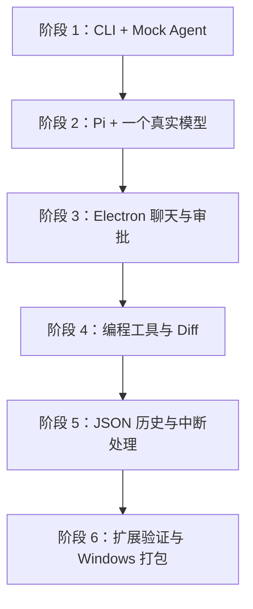
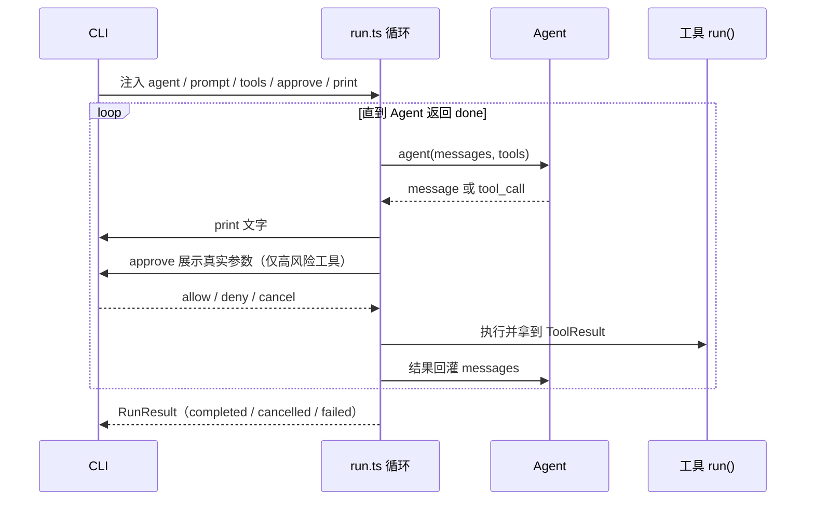
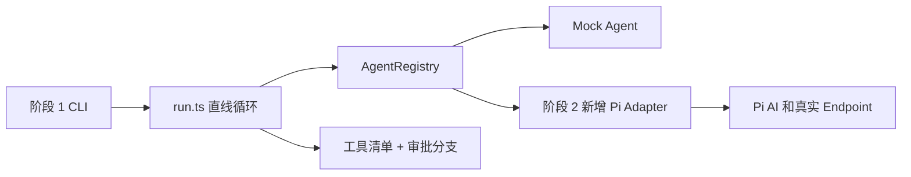
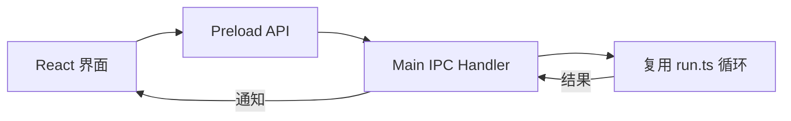
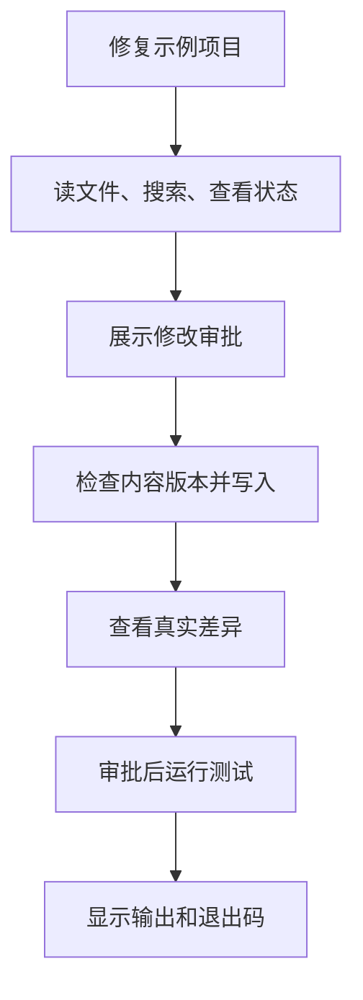
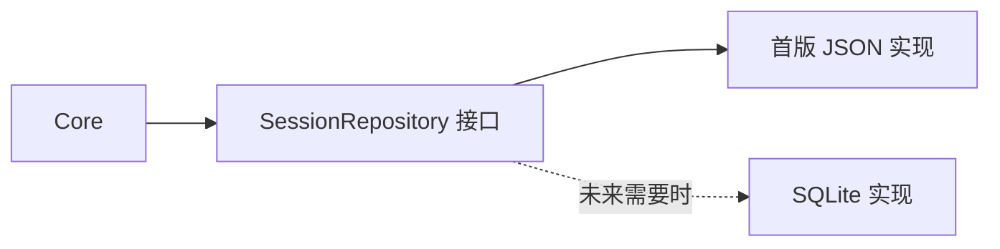

# 分阶段学习路线

本项目以理解原理为目标，不以一次性生成大量代码为目标。每阶段完成一个能观察、能解释的小闭环，再进入下一阶段。

本文件是学习路线，不是已经完成的实施清单；具体命令、文件和测试在各阶段实现后填写到阶段说明中。目标架构见[学习版架构](../architecture/2026-10-12-agent-desktop-design.md)。

## 1. 先后顺序

CLI 是学习入口，未来仍可作为调试工具。阶段 1 的注入直接写在 `cli.ts`；阶段 3 引入 Electron 时才把注入抽成共用装配，让两个入口复用同一条循环，只替换输入输出和审批实现。不要把目标形态的 Core / ToolService 当成阶段 1 已有的东西。

## 2. 阶段 1：先看清楚一条工具调用

**要理解：** 一次普通大模型调用需要注入什么，以及“模型请求工具”和“应用执行工具”是不同步骤。

**要交付：** Node CLI、一张 Agent 注册表（阶段 1 只有 Mock）、工具清单与参数校验、一条直线循环、终端审批。先用内存数据，不接 Electron 和付费模型。

和普通 LLM API 开发的差别只有两点：多一张 `Map<string, Agent>` 便于阶段 2 换 Pi；审批是循环里的一个分支。工具 `run()` 只返回结果，不认识界面，也不打印。审批按 `risk === "read"` 判断，阶段 1 只有 read / 非 read 两档行为，三档枚举与 GUI 展示属于后续目标，见[阶段 1 说明](../stages/01-cli-mock.md)「risk 现在到底做什么」。

先使用没有文件副作用的 `demo.confirm` 演练审批；`coding.read_file` 用临时工作区验证路径边界。Mock 不接大模型，只按上下文返回下一步。

**验收：** 允许、拒绝、取消产生不同结果；取消审批后工具没有执行；解释得出谁拥有循环、谁拥有权限；测试无需 API Key。

**阶段结束时能回答：** 为什么工具定义本身不是安全检查？阶段 2 换 Pi 时为什么不用改循环和工具？

## 3. 阶段 2：接入 Pi 和真实模型

阶段 2 分两步走：先纯文本对话，再叠加只读工具。每步独立验收，都能用 CLI 观察。

**要理解：** Agent 与模型、Provider 与 Endpoint、文本流与最终消息、工具代理，以及对话上下文由什么组成。

**步骤 2a：纯文本对话**

**要交付：** PiAgentAdapter，ModelProfile，一个 OpenAI Chat-compatible 配置，异步流式输出与取消。仍使用 CLI。

**验收：** 不修改 `run.ts` 循环与工具即可选 Pi 或 Mock；错误认证显示清晰错误；纯文本结束后只有一个终态；取消后不再继续发起模型请求。

**2a 结束能回答：** 一次对话的上下文由哪些消息组成？为什么 Adapter 要转换事件？

**步骤 2b：对话 + 只读工具**

**要交付：** 工具代理：Pi 的工具 execute 转为 `bridge.invokeTool()`，接入阶段 1 的 `coding.read_file`；工具结果回填 Agent 上下文继续对话。`bridge` 与 Core 都是本阶段新建的边界，阶段 1 只有一条循环和一组工具定义。

**验收：** 越出工作区的读取被拒绝且 Agent 收到结构化失败结果；取消传播到工具调用；同一问题在 Pi 与 Mock 下走相同的循环与审批路径。

**2b 结束能回答：** 工具结果在上下文里长什么样？一次 Run 为什么可能有多次模型请求？

图中 `run.ts 循环`、`AgentRegistry`、工具清单都是阶段 1 已有；`Pi Adapter` 是阶段 2 新增。Core、ToolService、bridge 尚未建立，不要在阶段 1 代码里找它们。核对所固定 Pi 版本的真实类型与事件；不要根据其他项目补丁猜 API。

## 4. 阶段 3：把输入输出换成桌面界面

**要理解：** Main、Renderer、Preload、IPC；函数返回与事件通知的区别。

**要交付：** React Chat，有限 DesktopApi，工具卡片，审批卡片，取消按钮。仍用 Mock 先调 UI，再接 Pi。

本阶段桌面端还没有设置界面，模型配置先用手工编辑的 `settings.json`（不含明文密钥）；设置界面与加密凭据在阶段 5 交付。

**验收：** Renderer 无 Node 权限；未知或不合法 IPC 参数被拒绝；一次事件不会因重复订阅出现两份；界面重载中断当前 Run，而非留下隐藏审批。

**阶段结束时能回答：** 为什么不向 Renderer 暴露通用 invoke？Agent 输入输出为什么可以从 CLI 换到 GUI？

## 5. 阶段 4：完成编程闭环

**要理解：** Workspace 路径、参数校验、写入冲突、命令退出码、Diff 的基线。

**工具顺序：** read_file → list_directory → search_code → git_status/git_diff → write_file/apply_patch → run_command。

工具由 CodingApplication 注册。先用自建临时项目，不拿重要代码库验证写入和命令。

本阶段还没有 Repository（阶段 5 交付），架构 9.1 的“副作用前保存快照”规则自阶段 5 起生效；本阶段依靠审批、取消和写入冲突检查控制写入与命令风险。

**验收：** 越出工作区的文件请求被拒绝；用户修改导致写入冲突；拒绝审批不产生副作用；stdout/stderr、超时、取消和非零退出码都有对应结果。

**阶段结束时能回答：** 为什么 cwd 不是 Shell 沙箱？Git Diff 中原有用户修改怎样区别于本次修改？

## 6. 阶段 5：保存历史，并如实处理失败

**要理解：** Repository 接口、JSON 写入、查看历史与恢复上下文的区别。

**要交付：** JsonSessionRepository，设置与加密凭据，会话历史，中断状态，输出文件引用。

**验收：** 重启可查看历史但不能误认为旧 Agent 已恢复；未完成 Run 被标记中断；不会自动重跑命令；损坏 JSON 有报告和备份处理；磁盘写失败不显示虚假成功。

**阶段结束时能回答：** 为什么文件修改和历史保存无法组成一个事务？为何 UI 文字不能代替原生 checkpoint？

## 7. 阶段 6：验证扩展与 Windows 发布

**要理解：** 边界是否真的成立，以及开发环境与安装环境的区别。

**要交付：** 一个演示应用模块、Agent 切换演示、自定义兼容模型演示、Windows 安装包、阶段文档。

演示应用可以只是一个有独立提示词和 `demo.echo` 工具的教程模块，不需要马上实现研究平台。Main/Renderer 通过同一个 Manifest 的 ID 注册各自实现。

**验收：** 不改 Core 即可增加演示应用；Pi import 只在 Adapter 内；新工具无需修改循环；干净 Windows 环境可启动，缺少 Git/Shell 或 Endpoint 不可用时提示清晰。

**阶段结束时能回答：** 哪个模块应该先拆进程？什么实际问题才值得引入 SQLite、Rust 或插件系统？

## 8. 每个阶段都留下什么

阶段说明用中文，固定包含：目标、数据流图、涉及模块、运行步骤、输入输出例子、验收证据、限制和常见错误。能用一条请求串起来说明，就不要只罗列一堆类名。

每次改接口同步更新对应图和示例。代码不是教材全文，背景原理写文档，关键接口的约束写注释，详见[文档与注释约定](../guides/documentation-and-comments.md)。
