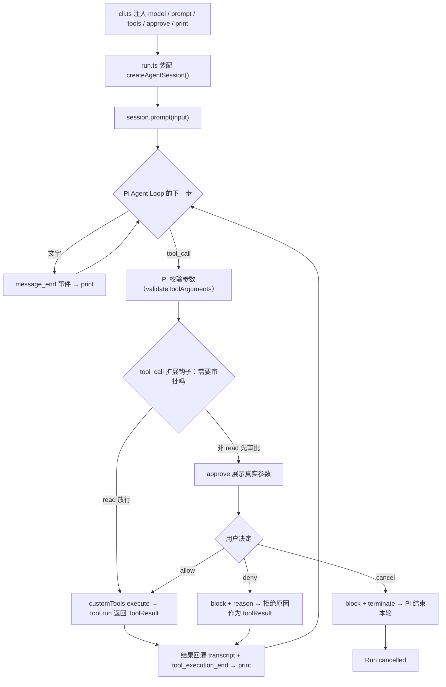

# 阶段 1：先看清楚一条工具调用（CLI + Pi SDK 会话）

- 日期：2026-10-14；结构、运行记录与 risk 语义固化：2026-11-15；改用 `createAgentSession()`：2026-11-15。
- 状态：已实现并通过验证；对应[学习路线](../learning/01-roadmap.md)阶段 1。

## 目标

在无 Electron、无 API Key 的条件下，观察一次完整的"输入 → Pi AgentSession → 工具审批 → 执行 → Run 结束"流程。

## 它和直接调用大模型 API 是一回事

普通的大模型调用就是注入三样东西：**模型、系统提示、工具清单**，然后由 Agent 循环：调用模型 → 是文字就输出，是工具调用就执行并把结果回灌上下文。本项目的差别只有两点：循环不再自己写，交给 Pi SDK 的 `createAgentSession()`；以及多了一个学习用的**审批边界**。

注入集中在 `cli.ts` 调用 `runTask(...)` 的一处：

```typescript
const { model, streamFn } = createPiModel(); // 模型注入：Pi AI 的两项配置，默认 faux 演示模型

const result = await runTask({
  input,
  model,                     // 模型注入（显式列出，不用 ...展开）
  streamFn,
  systemPrompt,              // prompt 注入
  tools: builtinTools,       // 工具注入
  workspace: process.cwd(),
  approve,                   // 边界 I/O：审批
  print,                     // 边界 I/O：正常输出的唯一出口
});
```

引入 Pi 后 `cli.ts` 只剩终端 I/O：解析任务文字、一次任务共用一条 readline 问 y/n/c、把 `RunResult.error` 打到 stderr 并在 `failed` 时设置非零退出码。开始 / 结束横幅由 `runTask` 通过注入的 `print` 输出，CLI 不再重复打印一份 `Run 记录`。

`run.ts` 是唯一调用 `createAgentSession()` 的地方，只做三件映射：把项目工具转成 SDK 的 `customTools`、把 `risk + approve` 挂到内联扩展的 `tool_call` 事件、把 `session.subscribe` 的事件收敛成 `print(text)`。参数校验、工具结果回灌、终止判据、取消信号都由 Pi 拥有，这里不写第二份循环。

工具仍是 `{ name, description, inputSchema, risk, run }`，`run()` 只返回 `ToolResult`，**不认识模型、界面、审批和打印**。和真实 API agent 一样，自定义工具与呈现是脱钩的。

### 为什么用 `createAgentSession()` 而不是 `new Agent(...)`

`new Agent()` 是 `@earendil-works/pi-agent-core` 的底层类；`@earendil-works/pi-coding-agent` 暴露的 `createAgentSession()` 才是上游推荐的 SDK 二开入口，它一次性装配好资源加载、扩展、系统提示、工具登记、会话持久化与事件订阅。本项目只接 Pi，直接用这一层就不再自己拼装 `AgentOptions`。

会话用 `SessionManager.inMemory()` / `SettingsManager.inMemory()` 避免写磁盘，`DefaultResourceLoader` 关闭自动发现（不读 AGENTS.md / 技能 / 扩展文件），`tools` 只放行注入的工具以关掉 SDK 自带的 read / bash / edit / write。演示模型是 Pi 自带的 `fauxProvider`，通过 `session.agent.streamFunction = streamFn` 接管响应流，全程不发网络请求；因为 SDK 默认只收录真实 provider，还需要把 `faux` 用 `ModelRuntime.registerProvider()` 注册成带占位 key 的自定义 provider，才能通过 `session.prompt()` 的鉴权预检。

## risk 现在到底做什么

`ToolRisk` 是三档枚举，但**当前只有一处生效**：`src/run.ts` 里 `tool_call` 扩展处理器的权限分支。读代码时不要把它当成已实现的分级策略。

| 位置 | 作用 |
| --- | --- |
| `src/contracts.ts` | `ToolRisk = "read" \| "write" \| "execute"`，同时是 `ToolDefinition.risk` 与 `ApprovalRequest.risk` 的类型 |
| `src/tools.ts` | `demo.echo` / `coding.read_file` 标 `read`，`demo.confirm` 标 `write`；没有任何工具标 `execute` |
| `src/run.ts` | `tool_call` 钩子里 `risk === "read"` 放行，其余走 `approve()`；这是唯一的权限判断 |
| `src/cli.ts` | `approve()` 只展示 `name` 与 `input`，**不读取 `request.risk`** |

三点如实记录，避免误判：

1. 三档枚举实际只有两档行为，等价于布尔 `needsApproval = risk !== "read"`；`write` 与 `execute` 走同一分支。
2. `ApprovalRequest.risk` 已随请求传出，但阶段 1 没有读取方——它是阶段 3 GUI 审批卡片的预留字段，当前终端审批只展示参数。
3. `risk` 来自工具定义，模型只返回工具名与参数，所以"模型不能指定风险"这条已兑现；分级策略本身还没实现。

**什么时候才改它**：阶段 4 出现真正的 `write_file` / `run_command` 时，再决定是让 `execute` 走更严格的审批，还是把字段化简成 `requiresApproval: boolean`。在那之前，判断行为以 `run.ts` 的分支为准，不要据枚举值推断。

## 数据流



`run.ts` 不再有循环：循环、参数校验与结果回灌都由 Pi 拥有。取消不是自己 `break`，而是给 `tool_call` 钩子返回 `{ block: true, terminate: true }`。正常输出统一经注入的 `print`，其中会话事件只在 `session.subscribe` 这一处映射；工具与模型都拿不到 `print`。

## 涉及模块

实现平铺在 `src/`，测试独立在 `tests/`，两个目录各只有一层。

| 路径 | 职责 |
| --- | --- |
| `src/contracts.ts` | 全部公共类型：`ToolRisk` / `ToolDefinition` / `ToolResult` / `ApprovalDecision` / `RunOptions` / `RunResult`；`RunResult.messages` 直接用 Pi 的 `AgentMessage[]` |
| `src/workspace.ts` | realpath + 相对路径校验，文件工具共用 |
| `src/tools.ts` | 工具注入清单（demo.echo、demo.confirm、coding.read_file）；`run()` 是纯执行函数，参数校验交给 Pi |
| `src/model.ts` | 唯一的模型配置：`createDemoModel()`（faux 脚本化回复）与 `createPiModel()`（YAGENT_MODEL 走 OpenAI-compatible） |
| `src/run.ts` | 唯一 `createAgentSession()` 调用点；工具适配、审批扩展、事件→打印三件映射；不再 `new Agent()` |
| `src/cli.ts` | 注入模型 / prompt / 工具与两个边界函数；共用一条 readline 让 `approve` 展示参数并读 y/n/c，`print` 是正常输出的唯一出口，错误走 stderr 并影响退出码 |
| `tests/*.test.ts` | 3 个测试文件、15 个用例；用 faux provider 脚本化回复，不需要 API Key 或假的 Gateway / Registry / Core 类 |

依赖固定为 `@earendil-works/pi-coding-agent` / `pi-agent-core` / `pi-ai` 1.5.2，`engines.node >= 22.19.0`；`pnpm-workspace.yaml` 关掉 postinstall（Pi 依赖不需要构建脚本）。

`tsconfig.json` 的 `include` 覆盖 `src` 与 `tests`，测试代码同样参与类型检查；`tests/` 可 import `src/`，反之禁止。

## 运行步骤

```text
pnpm install
pnpm check         # typecheck + 15 个测试
pnpm cli --help    # 用法与审批按键
pnpm cli "任意任务文字"
# 可选：YAGENT_MODEL=<model-id> + OPENAI_API_KEY 走真实模型
```

## 输入输出例子（真实运行记录，2026-11-15）

允许路径（输入 y）：

```text
=== Run 开始 ===
收到任务，我将调用演示工具处理。
[工具] 调用 demo.confirm ...

[审批] 工具 demo.confirm 请求执行：
  参数：{"text":"演示任务"}
  允许一次？(y=允许 / n=拒绝 / c=取消任务) [工具] demo.confirm 完成
演示完成，已收到工具结果。
=== Run 结束：completed ===
```

成功结束时不再重复打印 `Run 记录`；`failed` 时额外在 stderr 输出 `[错误] <原因>` 并返回非零退出码，`cancelled` 保持退出码 0。

拒绝路径（输入 n）：工具显示"未成功"，Pi 把"用户拒绝了工具 demo.confirm 的本次调用"作为 `isError` 的 toolResult 回灌，Run 仍以 completed 结束（Run 完成不等于任务成功；被拒也是一次正常结算）。

取消路径（输入 c）：`tool_call` 返回 `block + terminate`，工具不执行，Pi 结束本轮，输出 `=== Run 结束：cancelled ===`。

## 验收证据

- `pnpm test`：15/15 通过，覆盖允许 / 拒绝 / 取消、read 工具免审批、未知工具、Schema 校验失败、模型返回错误、默认演示脚本、工作区越界拒绝、工具纯函数。
- `pnpm typecheck`：tsc 严格模式无错误。
- CLI 允许 / 拒绝 / 取消三条路径的真实运行记录；`--help`、空参数用法提示、失败原因与退出码。
- 阶段问题回答：参数校验由 Pi 的 `validateToolArguments` 完成，权限判断集中在 `run.ts` 的 `tool_call` 扩展里，工具定义只提供 Schema 和 Handler，**工具本身不是安全检查**；换模型只需改 `model.ts`，不碰会话、工具与 I/O。

## 当前限制

- 演示脚本只调用 demo.confirm；coding.read_file 已注册并有测试，但流程不使用它。
- 无流式输出：`session.subscribe` 只处理 `message_end` 的整段文字，未消费 `message_update` 的 delta。
- 取消目前只在审批时按 c；由 `terminate` 在本批次后结束 Agent 循环，没有外部主动取消（界面"停止"按钮），也没有 `AbortSignal` 传播与子进程树终止。
- `RunResult.status` 只有 completed / failed / cancelled 三种终态；waiting_approval、cancelling、interrupted 属于阶段 3 / 5。
- `risk` 三档枚举只有 read / 非 read 两档行为，`execute` 无工具声明，`ApprovalRequest.risk` 无读取方；详见上文「risk 现在到底做什么」。
- `terminate: true` 要求本批次每个已结束的工具结果都带终止标记；当前用 `executionMode: "sequential"` 保证一次只处理一个工具调用，多工具并行时需重新验证。
- 无事件持久化、无单活动 Run 互斥；这些是桌面形态才需要的能力。
- 终端审批在 stdin 管道下表现为一次性应答。
- 演示模型走 `faux`，真实模型路径（YAGENT_MODEL + OPENAI_API_KEY）尚未做端到端验证。

## 常见错误

- Node 版本低于 22.19：`engines` 字段会拒绝安装，Pi SDK 也要求该版本。
- 直接 `node src/cli.ts`：不生效，需经 `pnpm cli`（tsx 加载 TypeScript）。
- 修改审批展示参数：界面只返回 allow / deny / cancel，改参数不会改变实际执行内容。
- 在工具 `run()` 里直接打印：会绕过正常输出的唯一出口 `print`，界面无法统一控制；要展示的内容应通过 `ToolResult.text` 返回。
- 以为改 `risk` 档位就能改变审批策略：当前只有 `read` 被特殊对待，其余档位行为完全相同。
- 自己再写一个"模型请求—工具执行"循环：循环归 Pi，`run.ts` 只做映射；重复实现会导致审批与打印出现两个出口。
