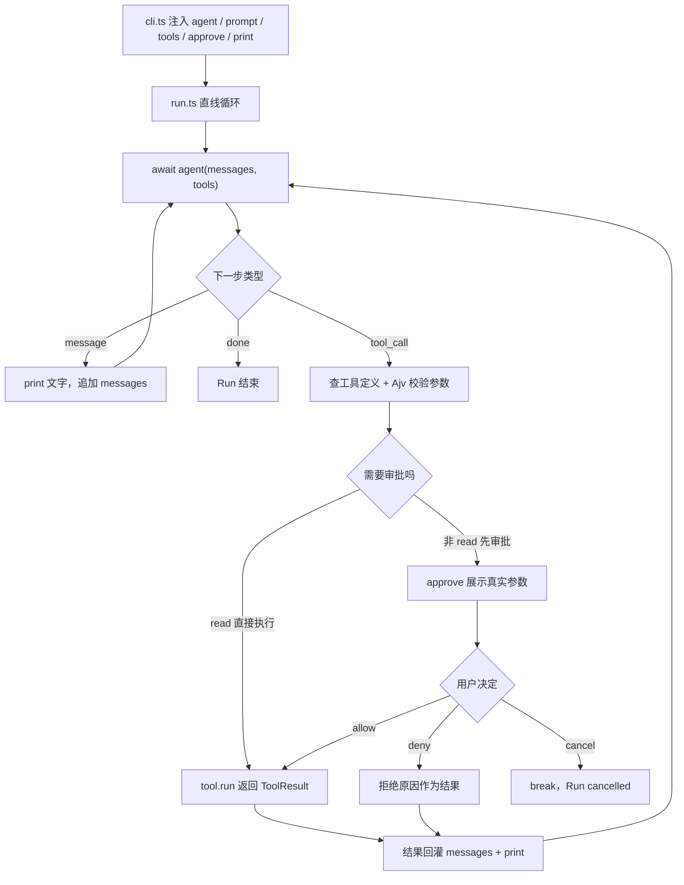

# 阶段 1：先看清楚一条工具调用（CLI + Mock Agent）

- 日期：2026-10-14；结构、运行记录与 risk 语义固化：2026-11-15。
- 状态：已实现并通过验证；对应[学习路线](../learning/01-roadmap.md)阶段 1。

## 目标

在无 Electron、无 API Key 的条件下，观察一次完整的"输入 → Agent → 工具审批 → 执行 → Run 结束"流程。

## 它和直接调用大模型 API 是一回事

普通的大模型调用就是注入三样东西：**模型（Agent）、系统提示、工具清单**，然后一个循环：调用模型 → 拿回一步 → 是文字就输出，是工具调用就执行并把结果回灌上下文。本项目只多了一层 **Agent 注册**（一张 `Map<string, Agent>`，阶段 2 换 Pi 时不动其余代码），以及一个学习用的**审批边界**。

注入集中在 `cli.ts` 调用 `runTask(...)` 的一处：

```typescript
const result = await runTask({
  input,
  agent: getAgent("mock"),   // 模型注入（+ Agent 注册）
  systemPrompt,              // prompt 注入
  tools: builtinTools,       // 工具注入
  workspace: process.cwd(),
  approve,                   // 边界 I/O：审批
  print,                     // 边界 I/O：打印
});
```

工具就是 `{ name, description, inputSchema, risk, run }`，`run()` 只返回 `ToolResult`，**不认识模型、界面、审批和打印**。和真实 API agent 一样，自定义工具与呈现是脱钩的。

## risk 现在到底做什么

`ToolRisk` 是三档枚举，但**当前只有一处生效**：`src/run.ts` 的权限分支。读代码时不要把它当成已实现的分级策略。

| 位置 | 作用 |
| --- | --- |
| `src/contracts.ts` | `ToolRisk = "read" \| "write" \| "execute"`，同时是 `ToolDefinition.risk` 与 `ApprovalRequest.risk` 的类型 |
| `src/tools.ts` | `demo.echo` / `coding.read_file` 标 `read`，`demo.confirm` 标 `write`；没有任何工具标 `execute` |
| `src/run.ts` | `risk === "read"` 直接执行，其余走 `approve()`；这是唯一的权限判断 |
| `src/cli.ts` | `approve()` 只展示 `name` 与 `input`，**不读取 `request.risk`** |

三点如实记录，避免误判：

1. 三档枚举实际只有两档行为，等价于布尔 `needsApproval = risk !== "read"`；`write` 与 `execute` 走同一分支。
2. `ApprovalRequest.risk` 已随请求传出，但阶段 1 没有读取方——它是阶段 3 GUI 审批卡片的预留字段，当前终端审批只展示参数。
3. `risk` 来自工具定义，模型只返回 `{ name, input }`，所以"模型不能指定风险"这条已兑现；分级策略本身还没实现。

**什么时候才改它**：阶段 4 出现真正的 `write_file` / `run_command` 时，再决定是让 `execute` 走更严格的审批，还是把字段化简成 `requiresApproval: boolean`。在那之前，判断行为以 `run.ts` 的分支为准，不要据枚举值推断。

## 数据流



循环只有 `run.ts` 一处。没有事件总线、订阅表、状态回报端口或装配根；审批是循环里的一个分支，取消是循环里的一个 `break`。打印只在循环里发生，工具与 Agent 都拿不到 `print`。

## 涉及模块

实现平铺在 `src/`，测试独立在 `tests/`，两个目录各只有一层。

| 路径 | 职责 |
| --- | --- |
| `src/contracts.ts` | 全部公共类型：`ToolRisk` / `ToolDefinition` / `ToolContext` / `ToolResult` / `ChatMessage` / `ModelReply` / `Agent` / `ApprovalDecision` / `RunOptions` / `RunResult`；叶子文件，不 import 实现 |
| `src/workspace.ts` | realpath + 相对路径校验，文件工具共用 |
| `src/tools.ts` | 工具注入清单（demo.echo、demo.confirm、coding.read_file）+ `validateInput`（Ajv 校验器按工具名缓存）；`run()` 是纯执行函数 |
| `src/agents.ts` | `Map<string, Agent>` 注册 + 阶段 1 的脚本化 Mock（按 messages 推导下一步，最后返回 done） |
| `src/run.ts` | 唯一循环，也是唯一权限判断处：判断 message / tool_call → 校验参数 → read 免审批 → 执行 → 打印 → 结果回灌；取消是 break |
| `src/cli.ts` | 注入三项依赖与两个边界函数；`approve` 展示参数并读 y/n/c，`print` 是唯一打印出口 |
| `tests/*.test.ts` | 3 个测试文件、16 个用例；直接注入函数即可测试，不需要造假的 Gateway / Registry / Core 类 |

`tsconfig.json` 的 `include` 覆盖 `src` 与 `tests`，测试代码同样参与类型检查；`tests/` 可 import `src/`，反之禁止。

## 运行步骤

```text
pnpm install
pnpm check         # typecheck + 16 个测试
pnpm cli "任意任务文字"
```

## 输入输出例子（真实运行记录，2026-11-15）

允许路径（输入 y）：

```text
=== Run 开始 ===
收到任务，我将调用演示工具处理。
[工具] 调用 demo.confirm ...

[审批] 工具 demo.confirm 请求执行：
  参数：{"text":"检查配置项"}
  允许一次？(y=允许 / n=拒绝 / c=取消任务) [工具] demo.confirm 完成
演示结果：已获批准并执行，原文：检查配置项
=== Run 结束：completed ===
Run 记录：{ "status": "completed" }
```

拒绝路径（输入 n）：工具显示"未成功"，Agent 收到"用户拒绝了工具 demo.confirm 的本次调用"，Run 仍以 completed 结束（Run 完成不等于任务成功；被拒也是一次正常结算）。

取消路径（输入 c）：审批直接返回 `cancel`，循环 `break`，工具不执行也不回灌结果，输出 `=== Run 结束：cancelled ===`。

## 验收证据

- `pnpm test`：16/16 通过，覆盖允许 / 拒绝 / 取消、read 工具免审批、未知工具、参数校验失败、Agent 抛错、Agent 重复与未注册报错、Mock 全流程、工作区越界拒绝、工具纯函数与参数校验。
- `pnpm typecheck`：tsc 严格模式无错误。
- CLI 允许 / 拒绝 / 取消三条路径的真实运行记录。
- 阶段问题回答：参数校验与权限判断集中在 `run.ts` 循环里，工具定义只提供 Schema 和 Handler，**工具本身不是安全检查**；阶段 1 没有 Core，换模型只需替换 `agents.ts` 里注册的 `Agent` 实现。

## 当前限制

- Mock 只调用 demo.confirm；coding.read_file 已注册并有测试，但流程不使用它。
- 无流式输出：Mock 一次返回完整文字；真实模型的 delta 流在阶段 2 接 Pi 时再设计。
- 取消目前只在审批时按 c，效果就是结束循环；没有流式请求或子进程需要中断，因此阶段 1 还没有 `AbortSignal`、也没有外部主动取消（界面"停止"按钮）。阶段 2 引入流式输出与真实子进程时再补传播机制。
- `RunResult.status` 只有 completed / failed / cancelled 三种终态；waiting_approval、cancelling、interrupted 属于阶段 3 / 5。
- `risk` 三档枚举只有 read / 非 read 两档行为，`execute` 无工具声明，`ApprovalRequest.risk` 无读取方；详见上文「risk 现在到底做什么」。
- `agent(messages, tools)` 收到的是完整 `ToolDefinition[]`（含 `run` 函数）。阶段 2 接真实模型前应只传 `{ name, description, inputSchema }` 的模型可见部分，避免模型侧代码绕过循环直接执行工具。
- 无事件持久化、无单活动 Run 互斥；这些是桌面形态才需要的能力。
- 终端审批在 stdin 管道下表现为一次性应答。

## 常见错误

- Node 版本低于 22：`engines` 字段会拒绝安装。
- 直接 `node src/cli.ts`：不生效，需经 `pnpm cli`（tsx 加载 TypeScript）。
- 修改审批展示参数：界面只返回 allow / deny / cancel，改参数不会改变实际执行内容（循环保存的是原始 `reply.input`）。
- 在工具 `run()` 里直接打印：会绕过唯一打印出口，界面无法统一控制；要展示的内容应通过 `ToolResult.text` 返回。
- 以为改 `risk` 档位就能改变审批策略：当前只有 `read` 被特殊对待，其余档位行为完全相同。
